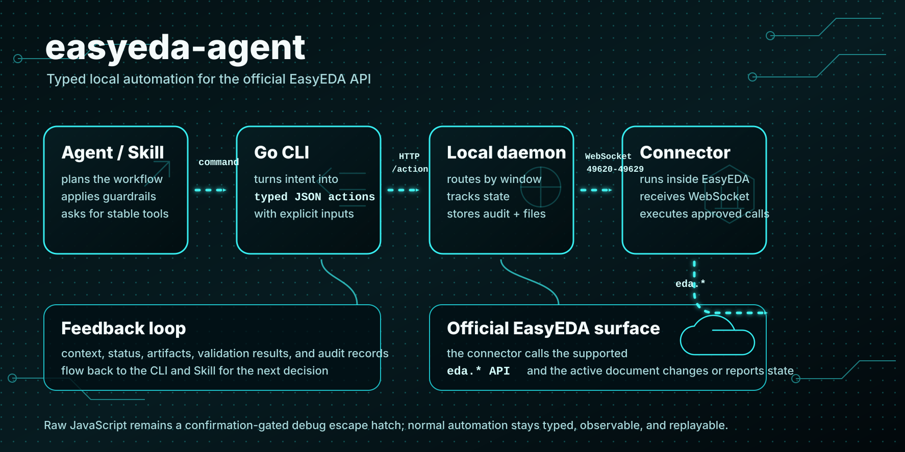

<p align="center">
  
</p>

<h1 align="center">easyeda-agent</h1>

<p align="center">
  Open-source AI automation for EasyEDA Pro: datasheets, schematics, PCB layout and verification.
</p>

<p align="center">
  <a href="https://easyeda-agent.daboluo.cc"><b>Project website</b></a> ·
  <a href="https://eda.daboluo.cc/#desktop"><b>Download Desktop beta</b></a> ·
  <a href="https://github.com/zhoushoujianwork/easyeda-agent/releases"><b>Releases</b></a> ·
  <a href="https://jlc-ext.com/item/zhoushoujian/easyeda-agent-connector"><b>Plugin marketplace</b></a> ·
  <a href="README.md">中文</a>
</p>



`easyeda-agent` connects AI agents to EasyEDA Pro (嘉立创 EDA 专业版) through the official
`eda.*` API. It combines a Go CLI and local daemon, a connector extension, an Agent Skill,
and a local stdio MCP adapter. Actions use typed inputs and structured readbacks so agents
can inspect real components, pins, nets, geometry, DRC results and saved state.

## Try EdaDesk Desktop

For an integrated workspace with projects, AI chat, schematics, PCB views and tool activity,
**[download the companion EdaDesk Desktop beta →](https://eda.daboluo.cc/#desktop)**.

| Option | Best for | Start here |
|---|---|---|
| **EdaDesk Desktop** | A desktop workspace for projects, chat and tools | [Downloads and installation](https://eda.daboluo.cc/#desktop) |
| **CLI / Skill / MCP** | Existing Codex or Claude Code workflows, scripts and tool integrations | [Install below](#install-the-open-source-tools) · [Quick Start](docs/quick-start.md) · [MCP setup](mcp/README.md) |

Desktop **0.1.0 beta** bundles easyeda-agent **1.16.0** and offers **macOS Apple Silicon**
and **Windows x64** packages through this project's
[public GitHub Release](https://github.com/zhoushoujianwork/easyeda-agent/releases/tag/v1.16.0#edadesk-desktop).
No private-repository access is needed. See the [Desktop website](https://eda.daboluo.cc/)
for current packages and supported platforms.

Desktop source remains private; an open-source date has not been decided. The engine in
this repository remains available under its existing licenses. The macOS beta is ad-hoc
signed and not notarized; the Windows beta is unsigned and has not been validated on a
Windows machine. Connect your own installed and authenticated local agent or a custom
model. Official Token grants and the unified model service are not open yet; downloading
the app does not grant credits. Start with a disposable test project.

## What it can do

| Workflow | Capabilities |
|---|---|
| Datasheet-driven libraries | Create Symbol, Footprint and Device assets from documented pin/package data; validate evidence and pin-to-pad mapping. [AS07 case study](docs/examples/as07-m1101d-sma/README.md) |
| Schematics | Component selection, canonical pin/net data, module composition, placement, wiring, normalization and readback checks |
| PCB layout and routing | Module-aware placement, board outlines, keepouts, rule-aware short routes, vias, copper pours and silkscreen adjustment |
| Reusable circuits | Reuse circuit-block topology and inspect native CBB assets; follow the [selection and reuse workflow](.agents/skills/easyeda-agent/references/part-selection.md) |
| Verification and delivery | Connectivity and geometry checks, official DRC, BOM, netlist, manufacturing exports, design drawings, audit logs and explicit saves |
| Agent integration | CLI, Agent Skill and [stdio MCP](mcp/README.md), including [DeepSeek Harness setup](docs/dsh-integration.md) |

See [CLI Status](docs/cli-STATUS.md), the [feature inventory](docs/FEATURES.md),
and the [schematic](docs/cli/schematic.md) / [PCB](docs/cli/pcb.md) command references
for current support and verification limits. Features do not imply that every generated
board is production-ready.

## Tell your agent what you need

After setup, ask a Skill-capable client to use `easyeda-agent`. For example:

```text
Use easyeda-agent to inspect the current schematic and PCB. Read real components,
pins, nets, board outline, stackup and DRC rules first. Repair only issues supported
by that data. Read back the changes, check connectivity, geometry and DRC, save,
and list anything that still needs an engineering decision.
```

For a new device library, provide the exact part suffix and its datasheet. Ask the
agent to search existing libraries first, verify pin/package evidence, validate the
specification offline, then create and read back the assets. See the
[library-authoring workflow](.agents/skills/easyeda-agent/references/library-authoring.md).

Examples and their acceptance boundaries:

- [AS07 symbol, footprint and device](docs/examples/as07-m1101d-sma/README.md).
- [AT32F415 parameterized layout](docs/260919-exam-execution-guide.md).
- [ESP32-S3 four-layer board, historical case](docs/showcase-esp32-mini.md).

## Install the open-source tools

Desktop users can follow the [Desktop installation guide](https://eda.daboluo.cc/#desktop).
For an existing AI client, install the CLI/daemon, connector and Skill:

### 1. Install CLI and Skill

macOS / Linux:

```bash
curl -fsSL https://raw.githubusercontent.com/zhoushoujianwork/easyeda-agent/main/install.sh | bash
```

Windows PowerShell 5.1 or PowerShell 7:

```powershell
irm https://raw.githubusercontent.com/zhoushoujianwork/easyeda-agent/main/install.ps1 | iex
```

Both installers verify asset SHA-256, CLI version and Skill version before replacing
installed files. They detect supported AI clients and print the connector download URL.
Options include `EASYEDA_VERSION`, `EASYEDA_INSTALL_DIR`, `EASYEDA_INSTALL_SKILLS`,
`EASYEDA_SKILL_PRESERVE` and `EASYEDA_GITHUB_PROXY`.

On Windows the default CLI directory is `%USERPROFILE%\.local\bin`. The installer
prints PATH instructions; automatic user-PATH changes require `-AddToPath` when run
from a file, or `EASYEDA_ADD_TO_PATH=1`. It does not change machine PATH.
See [Quick Start](docs/quick-start.md) for manual installation, upgrades and troubleshooting.

### 2. Install the connector

Install **EDA Agent Connector** from the
[official marketplace](https://jlc-ext.com/item/zhoushoujian/easyeda-agent-connector),
or import `easyeda-agent-connector.eext` from the
[latest GitHub Release](https://github.com/zhoushoujianwork/easyeda-agent/releases/latest)
using EasyEDA Pro's extension manager. Marketplace publication may lag behind GitHub;
check the actual installed components.

### 3. Open your project and check the connection

Enable **Settings → Allow external interaction** in EasyEDA Pro, then run:

```bash
easyeda health
```

The health report identifies daemon, connector, host, project and document readiness
and gives next steps. Commands start a missing daemon automatically unless
`EASYEDA_NO_AUTOSTART=1` is set. Use `easyeda update --check --exit-code` to inspect
installed release alignment.

The project targets **EasyEDA Pro V4**, with **V4.1.60 or newer V4** recommended.
Host compatibility and action availability are separate checks. See
[V4 compatibility](docs/v4-development.md). Version diagnostics do not authorize design writes.

## How it works

```text
AI client / Agent Skill / stdio MCP
                 │
                 ▼
      easyeda CLI + local daemon
        typed actions / audit / artifacts
                 │
                 ▼
      EDA Agent Connector (.eext)
             official eda.* API
                 │
                 ▼
          EasyEDA Pro project
```

Inspect the exact target before mutations. Read back pins, nets and geometry after
writes; explicitly save and reload at acceptance checkpoints. Screenshots and
successful command exits alone do not prove a circuit is correct.
See [architecture](docs/architecture.md) and [protocol](docs/protocol.md).

## Limitations

- Dense-board maze routing requires external Freerouting; the built-in router targets short, clear connections.
- The extension API has no programmable undo. Source checks, write guards, readbacks and failure rollback reduce risk.
- Dielectric thickness, Er and copper weight are not fully readable through the current API; automatic controlled-impedance approval is unsupported.
- Datasheet-based library creation needs exact part identity and adequate pin/package evidence. Missing evidence requires clarification.
- Software checks and historical examples do not establish physical, assembly or manufacturing acceptance.

## Develop and contribute

- [Public PCB solver packages and contribution plan](docs/pcb-solver-community-design.md): run `make pcb-solver-test` offline.
- [Circuit-block contribution guide](.agents/skills/easyeda-agent/references/standard-blocks-contributing.md).
- [Documentation index](docs/README.md), [development environment](docs/dev-environment.md) and [repository rules](AGENTS.md).
- [Public Agent Skill](.agents/skills/easyeda-agent/SKILL.md).

Development targets `dev`; validated changes are promoted to `main`.

Thanks to EasyEDA Pro for its official extension API,
[@jlceda/pro-api-types](https://www.npmjs.com/package/@jlceda/pro-api-types),
[Freerouting](https://github.com/freerouting/freerouting), and the
[official EasyEDA extensions](https://github.com/easyeda).

## License

[MIT](LICENSE). Files ported from
[Easy_EDA_PCB_Beautify](https://github.com/m-RNA/Easy_EDA_PCB_Beautify)
under `extension/src/beautify/` retain Apache-2.0; see [NOTICE](NOTICE).
These engine licenses do not grant a license to the private Desktop source.

## Star History

[](https://www.star-history.com/#zhoushoujianwork/easyeda-agent&Date)
